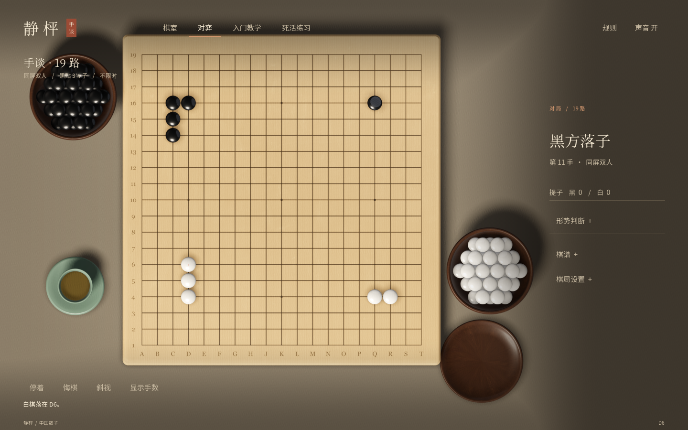
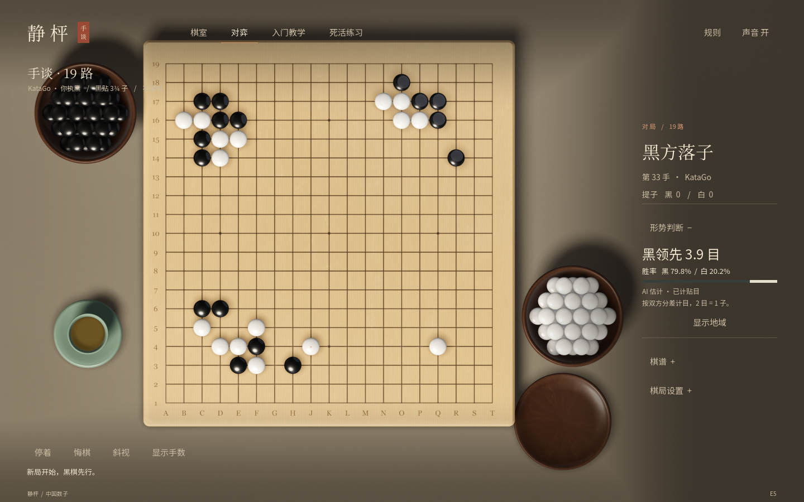

# 静枰 · 围棋

Windows / Godot 4.7.1 离线围棋游戏，版本 0.5.0。更新日期：2026-10-18。

## 开始玩

双击 **Play.cmd**。本机启动器会使用已经安装在 D:\godot 的 Godot 4.7.1；双击 **Edit.cmd** 打开工程编辑器。

如果旧版游戏还开着，先关闭旧窗口再启动，即可看到新版棋室。

这是可运行的 Godot 工程和启动器，尚未打包为自带引擎的独立安装程序。换电脑时请安装 Godot 4.7.1，打开 project.godot，或将 GODOT_EXE 设置为引擎可执行文件的完整路径。

## 当前内容

- **对弈**：9、13、19 路棋盘，同屏双人、执黑对入门陪练或本地 KataGo；落子、提子、停着、悔棋、认输、终局确认、SGF 棋谱导出。
- **形势判断**：可展开的黑白胜率、已计贴目的目差估计、可开关的预计地域。分析仅用于练习参考，不改动棋子或代替双方终局确认。
- **入门教学**：8 节独立交互课程——落子、气、连接、整块提子、禁入与提子优先、打劫、两只真眼、停着与数子。教学不会覆盖对局。
- **研习题库**：430 道离线练习。保留 10 道原创基础眼形题，新增 Go Game Guru 初级、中级、高级各 140 道，涵盖死活、对杀、劫争与手筋。目录按难度、进度、错题筛选，支持题号搜索、分页、上一题／下一题及筛选范围内随机练习。
- **连续作答**：按原题正确变化连续落子，自动应手；接受原谱多解，走到作者明确标注的正确结论才完成。重做会轮换可用的应手变化。提示跟随当前局面；独立完成与参考完成分别记录，新增题采用稳定来源编号保存进度。
- **学习反馈**：不接受的落点保持当前局面。区分原谱非正确变化与原谱未收录的着手，未收录不直接判定错误。原题英文评注在完成后可查看，来源和许可始终可查。基础题仍提供中文解释及提子演示。
- **棋具表现**：圆角厚边棋盘、扫描木纹与细直纹、带内壁的木棋罐、扁圆黑白子、茶盏与织物桌面。真实 HDR 环境参与反射，柔和阴影和环境遮蔽表现棋子与棋盘接触；格线直接印在表面。5 个云子落盘实录片段轮换播放。
- **便利操作**：默认俯视棋盘，可手动切换斜视；手数开关、悬停查看棋块气数、自动存档。

每次启动默认采用俯视视角。鼠标左键落子。V 切换俯视／斜视，N 切换手数，M 开关声音，Esc 收起设置、目录与棋谱。

## 本地 AI 与形势判断

首次使用先双击 **SetupAI.cmd**，从官方站点下载 KataGo 1.18.1 Windows OpenCL 引擎和 b18 模型，合计约 104 MB。之后完全离线运行，无需账号、Python 或云端服务。本机 RTX 3060 Ti 8GB 已安装并实测，下载文件不上传 GitHub。

进入“入席对弈 → 棋局设置 → KataGo 对弈”开始执黑人机局；对局右侧“形势判断”显示当前局面估计，再点“显示地域”观察黑白预计归属。快速／标准／深入控制搜索预算，不对应人类段位。原有“入门陪练”继续保留，适合熟悉操作。

首次显卡调优实测约 2 分钟，后续启动载入约 4 秒；本机独立测试中快速 9／13 路应手约 0.2–0.3 秒、标准 19 路中盘分析约 0.8 秒。速度随局面、设置和同时运行的程序变化。

胜率、目差和地域固定按黑方视角读取，切换行棋方不会颠倒数值；目差显示为领先方。分析中的“目”是双方分差，2 目相当于本游戏正式数子胜差的 1 子。区域大小表示 AI 对归属的确定程度，不表示已经确认的死子。

引擎代码采用 MIT，官方 b18 模型使用允许免费使用、修改、分发的 KataGo Neural Network License，均保留版权及许可。详情和安装故障说明见 [本地 AI 说明](engines/katago/README.md)，下载版本与校验值见 [source.json](engines/katago/source.json)。

0.3.0 重新设计界面：移除白色卡片、顶部实色导航栏和底部工具框，以宋体标题、暖色文字、细分隔线和暗部过渡衬托棋桌。首页只显示三个主要入口；对局棋谱、设置、教学目录按需展开。认输与导出棋谱位于“棋局设置”，教学和题目通过“打开目录”切换。

0.4.0 扩充题库并支持题谱变化树。打开“死活练习 → 打开目录”，选择基础、初级、中级或高级；每页最多 8 道，目录可滚动。搜索输入后按回车应用。角部题形默认放大，可点击“查看全盘”；镜头放大保留原始 19 路棋盘和所有棋子，未裁切边界或重造气数。

首页棋形是经过规则引擎验证的原创展示序列，不是职业棋谱，也不会写入玩家的实际棋局。画面由游戏实时渲染，未用效果图替代可交互画面。

## 明确采用的规则

本游戏固定使用 **中国数子法 + 禁自杀 + 位置禁全同** 的软件规则预设，黑贴还 **3¾ 子**，三种棋盘均使用同一贴子设置。它不是包含所有赛事程序、裁判酌处和特殊循环例外的中国比赛裁判系统。

1. 黑先白后，轮流在空交叉点落子。棋块按上下左右连接，共享不重复的气。
2. 先提取敌方所有无气棋块，再检查己方有气。这样能正确处理提子优先、倒扑与多块同时被提。
3. 禁止落子后出现任何历史上出现过的完整盘面；盘面使用完整序列比较。立即劫回提和较长循环都会被阻止。停着合法，不受重复盘面限制。
4. 双方连续停着进入死子确认。双方可整块标记／取消死子；更改标记会撤销此前的确认。两方确认后才给出正式结果。
5. 对死活有争议时继续对弈：恢复原棋子、清除死子标记，保留此前所有盘面历史。双活棋不应标成死子。
6. 数活子与围住空点；双方之间的空点平分。提子不另外加分。黑贴还 3¾ 子，等价于双方总分差贴 7.5 点。界面胜差用“子”；SGF 的 RE 属性用双方分差的“点”。

依据：[中国围棋协会《中国围棋规则》](https://wqwh.weiqi.org.cn/rules/)。实现明确选择位置禁全同，未把长生、三劫循环等赛事中的裁判处理伪装成已支持功能。

死子判断由使用者确认，**不会把形势估算当作最终裁判**。人机局也需要玩家复核双方死子并代双方确认。入门陪练是基础启发式对手；KataGo 是单独的本地神经网络对手，两者均不标称人类段位。暂未提供联网对弈。

## 设计调研与取舍

- [Just Go 官方商店说明](https://store.steampowered.com/app/1862520/Just_Go/)把三维棋具、独立入门教学、人机／双人和棋谱导出放在同一游戏里。本作参考这种清晰的内容划分，自行制作棋具与交互。
- [野狐官方下载说明](https://www.foxwq.com/soft.html)强调对弈、观战和学习；[其教学题目介绍](https://www.foxwq.com/news/listid/id/10513.html)强调答题与反馈。本作优先落实可操作的入门练习、多解接受和错题重试，未复制其界面、题库或美术素材。

## 素材来源

| 内容 | 来源与处理 |
| --- | --- |
| 木纹 | [Poly Haven / Fine Grained Wood](https://polyhaven.com/a/fine_grained_wood)，Rob Tuytel，CC0，2K 色彩、法线和粗糙度贴图。原文件不变，材质中重新调色并结合程序细直纹；不是某块榧木棋盘的扫描。 |
| 环境光 | [Poly Haven / Studio Small 09](https://polyhaven.com/a/studio_small_09)，Sergej Majboroda，CC0，1K HDR。用于棋具反射和环境照明。 |
| 落子录音 | [billhails2 / GoStoneSounds.ogg](https://freesound.org/people/billhails2/sounds/588317/)，CC0。作者录制的云子落在木棋盘上的声音；从公开高质量预览截取 5 段，去直流、短淡入淡出和控制电平，不改变音高。 |
| 棋具与界面 | 本项目原创程序化三维模型、着色器和 UI。白子贝纹为模拟纹理。 |
| 字体 | 优先使用本机已安装的 Noto Serif SC / Noto Sans SC，缺失时回退至宋体 / 微软雅黑 UI；棋盘坐标使用 Georgia。没有复制或分发字体文件。 |
| 新增题库 | [Go Game Guru / Weekly Go Problems](https://github.com/gogameguru/go-problems)，David Ormerod、An Younggil，CC BY-NC-SA 4.0；420 道带解答变化的题目。完整许可、原始 SGF、改编说明随游戏提供。 |

许可：[Poly Haven CC0](https://polyhaven.com/license)、[音频 CC0](https://creativecommons.org/publicdomain/zero/1.0/)。文件来源、处理参数和 SHA-256 见 assets/fine_wood/source.json、assets/studio/source.json 与 assets/audio/source.json。

新增题库单独使用 **CC BY-NC-SA 4.0**，包含非商业与相同方式共享条件；未来商业发行须另行取得适用授权或替换这部分内容。详见 [题库署名与改编说明](assets/problems/NOTICE.md)。

仓库各部分的许可范围见 [LICENSES.md](LICENSES.md)。代码尚未指定独立的软件开源许可证；公开上传不改变题库及素材的既有许可。

来源固定到提交 `eee12b2e39d59dbe81a8b9eaa7d4f103978d9224`。可用 Python 标准库运行 `tools/build_puzzles.py` 离线重建；逐个源文件比对上游 Git 对象，再校验着手合法性和作者正确标记。保留 37,436 个题谱节点、1,913 处正确结论标记。原谱一处多余括号仅在解析副本修正；一条无正确结论的重复盘面旁支未接入。两个附加演示题不计入 420 道。

原题标注 Japanese 规则，练习的完成条件是原作者局部参考解；本程序重放着手时仍执行禁自杀、位置禁全同。练习不自动数子或推断死活，劫活等结论按原题理解。检查通过表明收录着手可合法重放，不表示已穷尽全部可能解或证明所有作者判断。

## 验证

运行 tools/test.ps1；加 -Render 会在本机显卡上执行画面和鼠标流程检查；加 -KataGo 会调用已安装的真实引擎，检查对弈、分析、取消和故障恢复。两项可组合使用，截图来自实际游戏。测试使用 .runtime 中的隔离文件，不覆盖玩家正常存档。

本次：规则／教学 **7,459 项**、题库 **244,594 项**、原有无画面交互 **93 项**、原有真实渲染及交互 **115 项**检查通过。新增 KataGo 协议检查 **640 项**、真实引擎检查 **25 项**、AI 实际渲染与交互 **53 项**通过，包含真实引擎退出后的重试和双方连续停着的终局确认。题库检查逐分支重放全部收录节点；计数是程序断言数，不是独立人工棋例数。细节见 evidence/VALIDATION.md。

正常存档在 Windows 用户目录的 AppData/Roaming/Godot/app_userdata/静枰 · 围棋/quiet-go.json。每次操作通过临时文件替换保存。读取存档会重放合法着手以恢复全局历史。

新版已在 Windows + Godot 4.7.1 Forward+ / Vulkan + RTX 3060 Ti 上检查 1440×900 和 1100×720 窗口，包括小窗口的棋盘四角与中心实际鼠标落子。使用 4× MSAA 和时间抗锯齿稳定格线及细纹理。测试环境没有可用音频输出设备；已验证录音资源、片段波形与播放事件，尚未完成真人听感验收。没有把自动化测试等同于穷尽所有围棋局面。
